# 🧾 GhostLedger

**Snap a receipt, get a household ledger, and keep your finances as invisible as a ghost.**

> 🎃 A team project built at [Hacktoberfest Hack Day Budapest](https://www.mlh.com/events/hacktoberpest) (MLH, October 31, 2026).

GhostLedger is a privacy-first expense tracker powered by **Gemma 4**. Take a photo of a receipt and Gemma 4 reads it directly from the image (no separate OCR step). It turns the receipt into structured data — store, date, items, prices, categories, tax and total — and saves it to a local SQLite database or a CSV file.

You choose where the AI runs:

| Mode           | Model                                                       | API        | Where it runs       | Best for                                               |
| -------------- | ----------------------------------------------------------- | ---------- | ------------------- | ------------------------------------------------------ |
| 📴 **Offline** | Gemma 4 E2B (`gemma4:e2b`)                                  | Ollama API | Your own machine    | Poor connectivity, or finances you don't want to share |
| ☁️ **Online**  | Gemma 4 26B / 31B (`gemma-4-26b-a4b-it` / `gemma-4-31b-it`) | Gemini API | Google's Gemini API | Higher accuracy, monthly reports and deeper insights   |

Both modes use **the same Gemma 4 model family, the same prompts and the same output schema**. Only the model size and the place it runs change.

---

## ✨ Features

- **📸 Receipt → structured data:** Gemma 4 reads the receipt image and returns validated JSON.
- **✅ Self-checking:** item totals are compared with the receipt total. Mismatched rows are highlighted, and you can fix them in an editable table before saving.
- **💾 Your ledger stays on your machine:** records are stored in a local SQLite file, and you can export them to CSV with one click. There is no GhostLedger server or account.
- **🌍 Multilingual receipts:** it reads receipts in any language (for example Hungarian, Japanese or English), translates item names and normalizes currencies.
- **🔀 One-click mode switch:** toggle between Offline and Online. If there is no internet connection or no API key, the app falls back to Offline automatically.
- **🛡️ Privacy levels for Online insights:**
  - **Aggregates only (default):** only category totals (e.g. "Groceries: 42,000 HUF, Eating out: 12 times") are sent. Individual items never leave your machine.
  - **Full data:** send the detailed records for finer-grained analysis.
  - **Preview before sending:** you always see the exact payload before anything leaves your device.
- **📊 Insights:** monthly summaries, overspending alerts and saving suggestions. In Online mode they are generated by Gemma 4 31B with thinking enabled.

### Stretch goals

- 💬 Ask your ledger questions, e.g. "How much did I spend on convenience stores this month?" (Gemma 4 function calling)
- 🎙️ Voice input for cash expenses, e.g. "Coffee, 900 yen, cash" (Gemma 4 E2B/E4B audio input — _to be verified with Ollama_)

---

## 📱 Demo: mobile version

These screenshots show a demo of the mobile version of GhostLedger, walking through how to use it.

The badge in the top-right corner always shows where the AI runs: **🔒 On this phone** (Offline) or **☁️ Gemini** (Online). The bottom bar has four tabs: **Home**, **Add**, **Insights** and **Settings**.

### 1. Home: your ledger

<table>
<tr>
<td width="50%">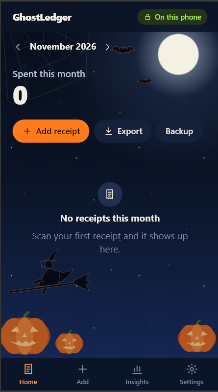</td>
<td>

- Shows how much you have **spent this month**. Use `<` and `>` to switch months.
- **Add receipt** opens the Add screen.
- **Export** downloads your receipts as a CSV file.
- **Backup** downloads the whole ledger database file.

</td>
</tr>
</table>

### 2. Add a receipt

<table>
<tr>
<td width="50%">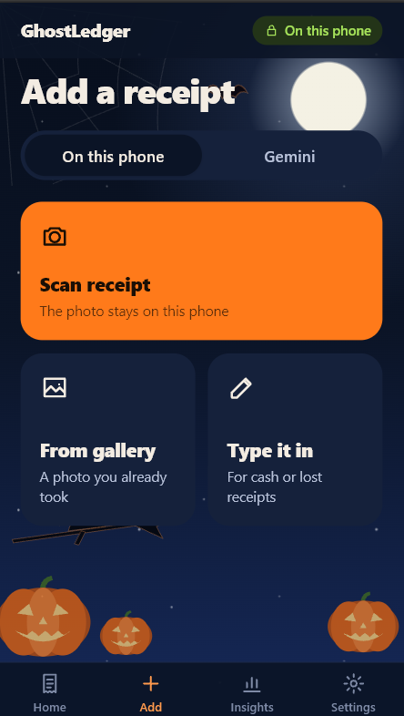</td>
<td>

1. Choose who reads the receipt: **On this phone** (Gemma 4 E2B, Offline) or **Gemini** (Online).
2. Choose how to add it:
   - **Scan receipt:** take a photo with the camera.
   - **From gallery:** pick a photo you already took.
   - **Type it in:** enter a cash or lost receipt by hand.

</td>
</tr>
</table>

### 3. Gemma 4 reads the receipt

|                                        Loading the model                                        |                                          Reading the receipt                                           |
| :---------------------------------------------------------------------------------------------: | :----------------------------------------------------------------------------------------------------: |
| 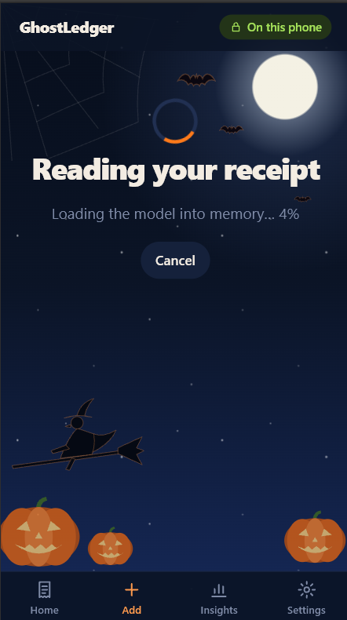 | 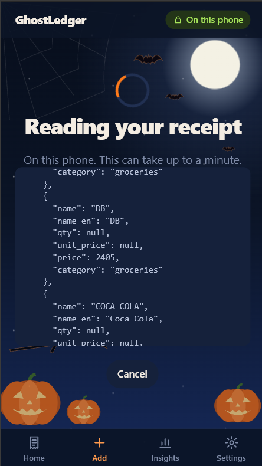 |
|          The first time after the app starts, the Offline model is loaded into memory.          |          You can watch Gemma 4 write the receipt as JSON, live. This can take up to a minute.          |

### 4. Check and save

|                                                    Receipt details                                                    |                                                                 Items                                                                  |
| :-------------------------------------------------------------------------------------------------------------------: | :------------------------------------------------------------------------------------------------------------------------------------: |
|           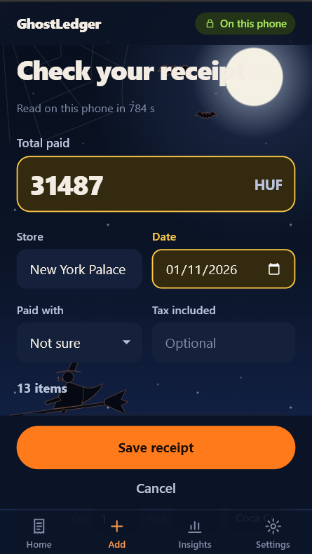           |                      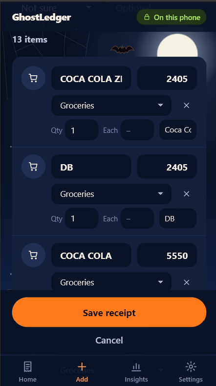                       |
| Check the **total**, **store**, **date**, **payment method** and **tax**. Highlighted fields are worth a second look. | Every item has a name, price, **category**, quantity and an English translation. Fix anything that's wrong, then tap **Save receipt**. |

<table>
<tr>
<td width="50%">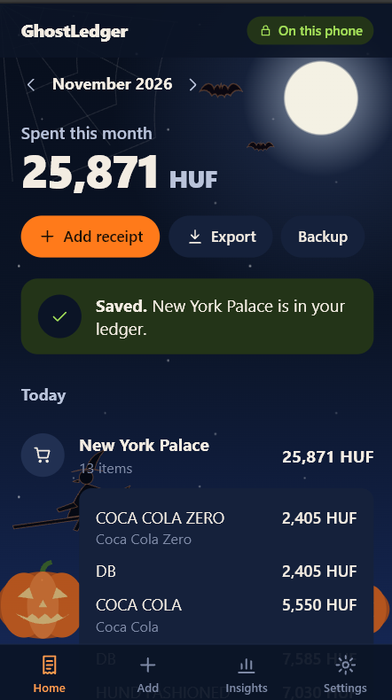</td>
<td>

The receipt now appears in your ledger. Tap it to see its items. The monthly total uses the sum of the item prices.

</td>
</tr>
</table>

### 5. Insights

|                                                                                             Where your money went                                                                                              |                                                           Preview what is sent                                                           |
| :------------------------------------------------------------------------------------------------------------------------------------------------------------------------------------------------------------: | :--------------------------------------------------------------------------------------------------------------------------------------: |
|                                                              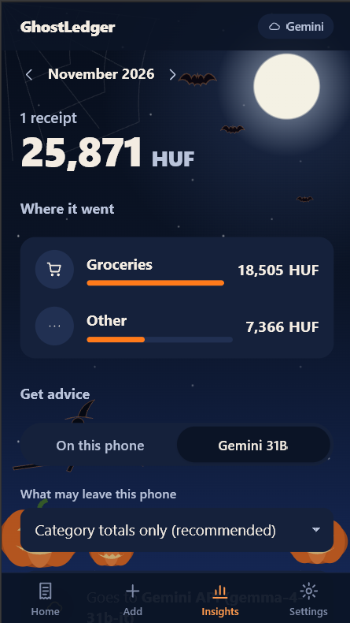                                                              |                  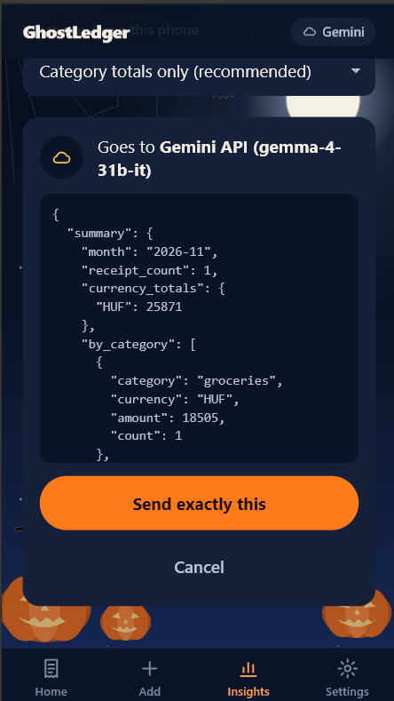                   |
| See your spending by category. Under **Get advice**, choose **On this phone** or **Gemini 31B**, and choose **what may leave this phone**: _Category totals only (recommended)_ or _Every item, never images_. | Before anything is sent, you see **the exact JSON** that will go to the Gemini API. Nothing is sent until you tap **Send exactly this**. |

|                                      Thinking                                      |                                                 Your report                                                 |
| :--------------------------------------------------------------------------------: | :---------------------------------------------------------------------------------------------------------: |
| 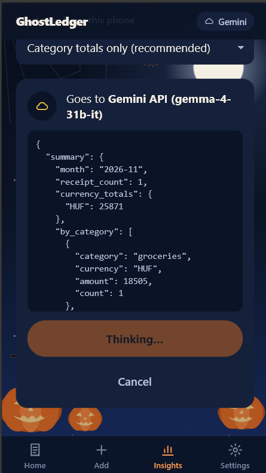 | 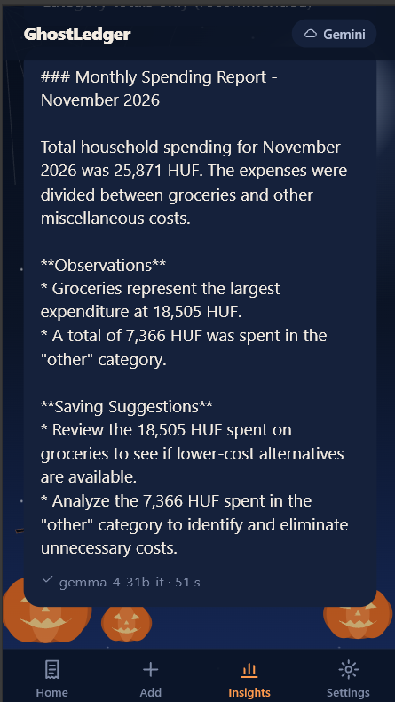 |
|               Gemma 4 31B analyzes the month with thinking enabled.                |                     You get a monthly report with observations and saving suggestions.                      |

### 6. Settings

- **Offline model:** download, pause, resume or delete **Gemma 4 E2B**, and test whether it fits in memory.
- **Preferences:** which mode reads receipts by default, and the language for advice.
- **Gemini (optional):** your API key, or a proxy URL.
- **This phone:** whether GPU acceleration (WebGPU) is available, and how much storage is used.

---

## 🧠 How GhostLedger uses Gemma 4

| Gemma 4 capability                           | How we use it                                                                          |
| -------------------------------------------- | -------------------------------------------------------------------------------------- |
| Small (E2B/E4B) and large (26B/31B) variants | Offline: E2B on-device (4.6 GB). Online: fast 26B MoE for extraction, 31B for insights |
| Open weights                                 | Offline mode runs fully on-device, and no data leaves your machine                     |
| Image input                                  | Reads receipts directly, with no OCR pipeline                                          |
| Multilingual                                 | Handles foreign receipts and translates item names                                     |
| Long context                                 | Analyzes a whole month of transactions in one prompt                                   |
| Thinking mode                                | Enabled for Online insights, for higher-quality analysis                               |
| Function calling                             | Ledger Q&A over the database (stretch goal)                                            |

> ⚠️ Model tags, sizes and license details are based on the [Ollama library page](https://ollama.com/library/gemma4) and the [Gemini API docs](https://ai.google.dev/gemma/docs/core/gemma_on_gemini_api) at the time of writing. Check them against the official pages before relying on them.

---

## 🏗️ Architecture

```
Browser (PC / phone)
   │
   ▼
┌─ frontend (Streamlit, :8501) ────────────┐
│  UI only — talks to the backend via REST │
└──────────────────┬───────────────────────┘
                   │ HTTP  /api/v1  (docs/openapi.yaml)
                   ▼
┌─ backend (FastAPI, :8000) ────────────────────────────┐
│  extractor.py ── LLMProvider ──┬─ OllamaProvider ─────┼──▶ Ollama (gemma4:e2b)   📴 Offline
│  ledger.py   (SQLite / CSV)    └─ GeminiProvider ─────┼──▶ Gemini API (Gemma 4 26B / 31B)    ☁️ Online
│  insights.py (aggregation + privacy filter)           │
└───────────────────────────────────────────────────────┘
        data/ledger.db
```

- **API contract:** the frontend and backend share only the REST API defined in [`docs/openapi.yaml`](docs/openapi.yaml). See [`docs/API.md`](docs/API.md) for the main flows and how to develop the frontend against a mock server.
- **`LLMProvider`:** a single interface with two methods, `extract(image) -> Receipt` and `analyze(summary) -> str`. Switching modes just swaps the implementation.
- **`OllamaProvider`** uses Ollama's structured output (`format=<JSON schema>`), which is more robust than tool calling for extraction. It also sets `think: false`: in our test this was about 3× faster with no loss in accuracy.
- **`GeminiProvider`** asks for JSON that matches the `Receipt` schema, and uses `thinking_level="high"` for insights.
- Both providers validate the output with Pydantic and retry once if validation fails.
- **Post-processing in code, not in the model:** the app recomputes the item total itself, trusts the line prices over quantity × unit price, normalizes currency symbols to ISO codes (e.g. `Ft` → `HUF`), and converts a tax _rate_ to a tax _amount_ when needed.

### 💡 Idea: a local-first mobile app

The mobile version is an idea we believe is feasible: the phone would run everything offline, including the UI, Gemma 4 E2B (Transformers.js + WebGPU) and the SQLite ledger (WASM on OPFS). The proposed design is in [`docs/ARCHITECTURE.md`](docs/ARCHITECTURE.md), and the code it would build on is here:

| Path             | What                                                                                                                                               |
| ---------------- | -------------------------------------------------------------------------------------------------------------------------------------------------- |
| `apps/web/`      | React + Vite PWA: Scan, Ledger, Insights and Settings screens                                                                                      |
| `packages/core/` | TypeScript logic used by the app: schemas (Zod), prompt, post-processing, validation, `LLMProvider` (local + Gemini), ledger, insights, CSV export |

To run it, see [Run GhostLedger on your PC](#-run-ghostledger-on-your-pc).

---

## 🚀 Run GhostLedger on your PC

GhostLedger is a web app (PWA) that runs entirely in your browser. There is no backend server to set up: the UI, Gemma 4 E2B and the SQLite ledger all run on your device.

### Requirements

- **Git** and **Node.js 22 or later** (`node -v` to check)
- **A recent Chrome or Edge.** They support WebGPU, which runs the Offline model on your GPU. Without WebGPU it still works, but slowly.
- **About 3 GB of free storage** for the Offline model, plus enough free memory to load it
- _(Optional, for Online mode)_ A Gemini API key from [Google AI Studio](https://aistudio.google.com/apikey)

### 1. Clone and install

```bash
git clone https://github.com/Ashley-omy/ghostledger.git
cd ghostledger
npm install
```

### 2. Start the app

```bash
npm run dev
```

Open **http://localhost:5173** in Chrome or Edge.

<details>
<summary>Other ways to run it</summary>

```bash
npm run build && npm run preview   # production build at http://localhost:4173 (service worker on: installable, works offline)
npm run phone                      # the same build, reachable from other devices on your network
npm test                           # core unit tests
```

Service workers, WebGPU and OPFS need a secure origin. `localhost` works, but on a phone you need HTTPS: use a tunnel such as `cloudflared` or `ngrok`.

</details>

### 3. Set up a mode

You need at least one of the two modes before you can read receipts.

#### 📴 Offline mode: download Gemma 4 E2B (once)

1. Open the **Settings** tab.
2. Under **Offline model → Gemma 4 E2B**, tap **Download**. It is about 3 GB and downloaded once from Hugging Face ([`onnx-community/gemma-4-E2B-it-ONNX`](https://huggingface.co/onnx-community/gemma-4-E2B-it-ONNX)). Use Wi-Fi. You can pause and resume it, and keep the app open while it downloads.
3. When it shows **Ready**, tap **Test: load into memory** to check that your device has enough memory.
4. Check **This phone → GPU acceleration**. If it says **No**, reading a receipt will be very slow.

After this, Offline mode works without an internet connection.

#### ☁️ Online mode: add your Gemini API key

1. Create an API key in [Google AI Studio](https://aistudio.google.com/apikey).
2. Open **Settings → Gemini (optional)** and paste it into **API key**.
3. To use Gemini by default, set **Preferences → Read receipts** to **With Gemini**. You can also switch per receipt on the Add screen.

> 🔐 The key is saved only in this browser's storage on your device. It is never written to the repo or to a `.env` file. Don't enter it on a shared computer. If you don't want the key in the browser at all, put it behind a small proxy and enter its address in **Proxy URL**.

### 4. Add your first receipt

Go to **Add → Scan receipt** or **From gallery**, check the result and tap **Save receipt**. See [Demo: mobile version](#-demo-mobile-version) for the mobile demo.

---

## 🔒 Privacy

|                       | Offline mode             | Online mode                                                      |
| --------------------- | ------------------------ | ---------------------------------------------------------------- |
| Receipt images        | Stay on your machine     | Sent to the Gemini API for extraction                            |
| Insights              | Computed on your machine | Aggregates only (default) or full data, previewed before sending |
| Ledger database / CSV | Stay on your machine     | Stay on your machine                                             |

Nothing is ever sent to any service other than the Gemini API, and only in Online mode.

---

## 📁 Project Structure

```
ghostledger/
├─ docs/
│  ├─ openapi.yaml     # API contract (source of truth)
│  └─ API.md           # flows, data rules, mock server
├─ backend/
│  ├─ app/
│  │  ├─ main.py       # FastAPI app + routes (/api/v1)
│  │  ├─ schemas.py    # Pydantic models matching docs/openapi.yaml
│  │  ├─ extractor.py  # prompts + validation/retry + post-processing
│  │  ├─ providers.py  # LLMProvider, OllamaProvider, GeminiProvider
│  │  ├─ ledger.py     # SQLite + CSV export
│  │  └─ insights.py   # aggregation + privacy filter + preview hash
│  └─ requirements.txt # fastapi, uvicorn, python-multipart, ollama, google-genai, pydantic
├─ frontend/
│  ├─ main.py          # Streamlit UI (scan, edit, ledger, insights, mode toggle)
│  ├─ api_client.py    # thin wrapper over the REST API (API_BASE_URL)
│  └─ requirements.txt # streamlit, requests, pandas
├─ data/               # ledger.db (git-ignored)
├─ samples/            # sample receipts (personal info removed)
├─ .env.example
└─ LICENSE             # Apache-2.0
```

---

## ⚠️ Limitations

- The offline E2B model misreads quantities, unit prices and item translations more often than the online models, and its output can vary between runs. The self-check and edit screen exist for this reason, so always review a receipt before saving it.
- Offline extraction speed: in our test (CPU only, AMD Ryzen 5 7530U, 14 GB RAM), one receipt took about **19 s** with thinking off and about 52 s with thinking on. A GPU makes it much faster.
- Offline mode needs an internet connection once, to download the model. After that, no connection is required.

---

## 📄 License

Apache-2.0
