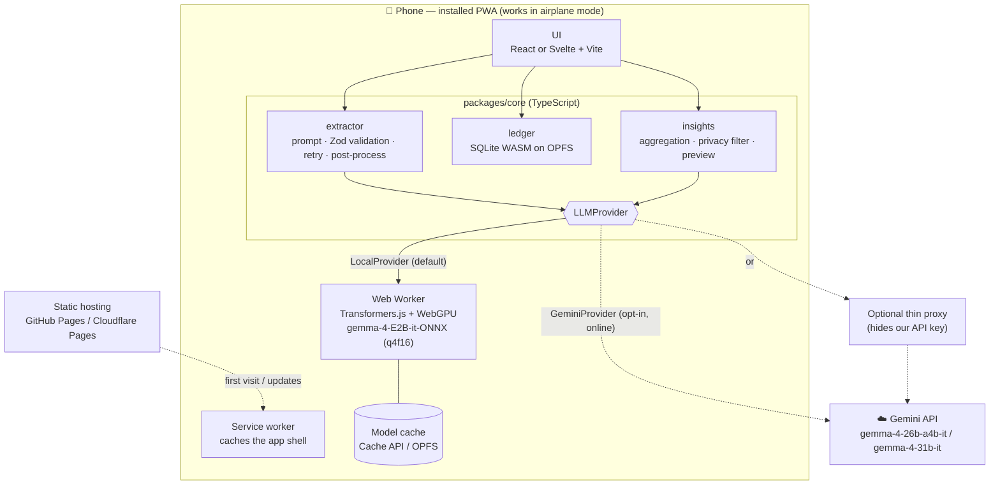
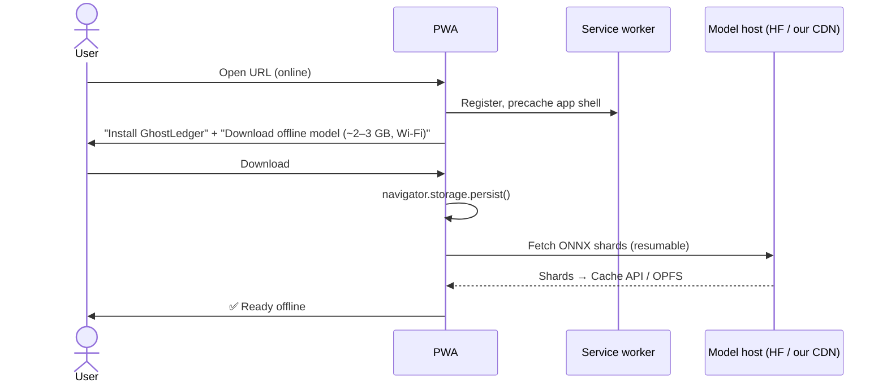
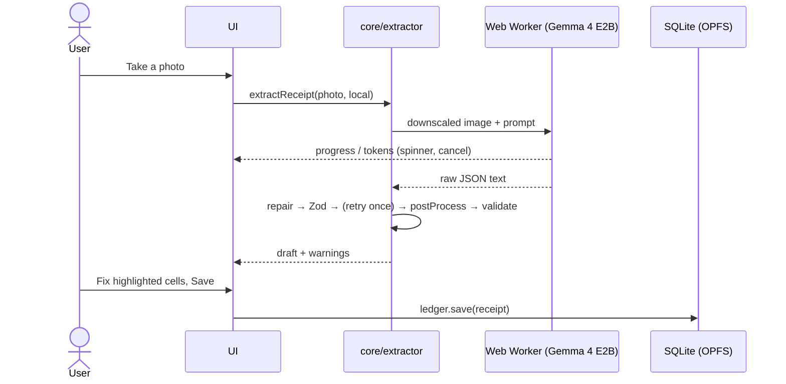

# GhostLedger architecture: local-first mobile PWA (proposal)

> **Status:** draft for team discussion. Nothing here is implemented yet.
> **Goal:** GhostLedger works **offline on a phone by default**. The server becomes optional and is only used for Online mode.

---

## 1. Why we need to change the current design

The current design (README → Architecture) is offline only from the point of view of **your own computer**:

```
Phone browser ──▶ Streamlit (server) ──▶ FastAPI (server) ──▶ Ollama (server)
```

On a phone with no network, every arrow fails:

| Part | Why it can't work offline on a phone |
|---|---|
| Streamlit | Renders the UI on the server over a live WebSocket. No connection means no UI |
| FastAPI + SQLite | Run on a server. A phone browser can't run Python or a server process |
| Ollama | Native server process. It can't run inside a mobile browser |

Turning this into a PWA (a manifest plus a service worker) doesn't help, because a service worker can only cache files. It can't run our backend.

**So the phone has to run the UI, the model and the database itself.**

---

## 2. Principles

1. **Local-first.** Every core feature works in airplane mode: scan → review → save → list → summary → CSV.
2. **Offline is the default; Online is opt-in.** The user chooses Online, and the app never silently falls back to it.
3. **One implementation of the logic.** Prompts, validation, post-processing and aggregation exist once, in TypeScript (`packages/core`), and both modes use them.
4. **The provider is swappable.** `LLMProvider` keeps the same interface, so the local runtime can later move from the browser (WebGPU) to native (Capacitor + LiteRT-LM / llama.cpp) without touching the UI.
5. **The privacy rules stay the same.** Images never leave the device. Online insights send only the payload the user saw in the preview.

---

## 3. Target architecture



**What is on the device:** the app shell, the model weights, the ledger database and all of the business logic.
**What is off the device (optional):** the Gemini API, an optional proxy, and the static hosting the app is first installed from.

---

## 4. Mapping current components to the new ones

| Current (README / CLAUDE.md) | New | Notes |
|---|---|---|
| `frontend/` Streamlit | `apps/web` React or Svelte + Vite + `vite-plugin-pwa` | Static files, precached by the service worker |
| `backend/app/main.py` routes | `packages/core` functions, one per operation in `openapi.yaml` | Called in-process instead of over HTTP |
| `schemas.py` (Pydantic) | Zod schemas generated from `docs/openapi.yaml` (e.g. `openapi-zod-client`) | `openapi.yaml` stays the source of truth for the shapes |
| `extractor.py` | `core/extractor.ts` | Same prompt constant and the same post-processing rules (skill `llm-extraction`) |
| `providers.py` `OllamaProvider` | `core/providers/local.ts` + `local.worker.ts` | Transformers.js running `onnx-community/gemma-4-E2B-it-ONNX` |
| `providers.py` `GeminiProvider` | `core/providers/gemini.ts` (`@google/genai`) | Uses the user's own key, or goes through the proxy |
| `ledger.py` SQLite `ledger.db` | `core/ledger.ts`: SQLite WASM (`@sqlite.org/sqlite-wasm`) on OPFS | Keeps our SQL. Fallback: Dexie / IndexedDB |
| `insights.py` | `core/insights.ts` | The payload is built and previewed on the device |
| `GET /export.csv` | `core/export.ts`: build a Blob, then share or download | Works offline |
| `GET /health` | `core/capabilities.ts` | WebGPU? `shader-f16`? Model downloaded? Online with a key? |
| `compose.yaml` + Ollama container | Dev only (optional) | The product is static hosting |

---

## 5. Key interfaces (sketch)

```ts
// packages/core/providers/types.ts
export interface LLMProvider {
  id: 'local' | 'online';
  model: string;                       // 'gemma-4-E2B-it-ONNX' | 'gemma-4-26b-a4b-it' …
  available(): Promise<{ ok: boolean; reason: string | null }>;
  extract(image: Blob, opts?: { onProgress?: (p: Progress) => void; signal?: AbortSignal }): Promise<string>; // raw model text
  analyze(payload: object, opts?: { language?: string }): Promise<string>;                                    // markdown
}

// packages/core/extractor.ts — same pipeline for both providers
export async function extractReceipt(image: Blob, provider: LLMProvider): Promise<ExtractionResult> {
  const small = await downscale(image, 1024);           // fewer vision tokens = faster on phones
  let raw = await provider.extract(small);
  let parsed = ReceiptInput.safeParse(repairJson(raw));
  if (!parsed.success) {                                // retry once, with the error appended
    raw = await provider.extract(small, /* + validation error in prompt */);
    parsed = ReceiptInput.safeParse(repairJson(raw));
    if (!parsed.success) throw new AppError('EXTRACTION_FAILED');
  }
  const draft = postProcess(parsed.data);               // items_sum, currency ISO, tax rate→amount, qty default…
  return { draft, validation: validate(draft), meta: { mode_used: provider.id === 'local' ? 'offline' : 'online', … } };
}
```

The UI calls `core` directly and never touches a model SDK or SQL.

---

## 6. Main flows

### 6.1 First run: install the app and download the model



- Until the model is downloaded, the user can still add expenses manually, or use Online mode if they've enabled it.
- Show the storage used and offer a "Delete model" button in Settings.

### 6.2 Scan → review → save (offline, the default)



- **Optional upgrade:** if there are `TOTAL_MISMATCH` warnings **and** the device is online **and** Online mode is enabled, offer "Re-check with Gemma 4 26B". This is never automatic, because the image would leave the device.

### 6.3 Insights

- **Offline (default):** E2B generates a short summary from the `Summary` aggregates on the device.
- **Online (opt-in):** `core/insights` builds the payload (`aggregates` or `full`) → the UI shows the exact JSON → the user confirms → exactly those bytes are sent.
  Because the same code builds, shows and sends the payload, we **no longer need `payload_hash` / `409 PREVIEW_MISMATCH`** between the client and the server.

---

## 7. Mode selection

| Situation | Extraction | Insights |
|---|---|---|
| Model downloaded, WebGPU OK | **Local E2B** (default) | Local E2B |
| Model not downloaded yet | Manual entry, or Online if enabled | Summary tables only, or Online |
| No WebGPU / unsupported device | WASM fallback (slow, with a warning), Online if enabled, or manual entry | Online if enabled |
| User chooses Online, has a connection and a key | Gemini 26B | Gemini 31B (thinking) |

- `DEFAULT_MODE` becomes `offline`.
- **No silent fallback to Online.** If the user asked for Online and there's no network, fall back to Offline with a notice. The other direction always needs the user's consent.

### Gemini API key: decide one
| Option | Pros | Cons |
|---|---|---|
| **A. The user brings their own key** and it's stored on the device | No server at all; matches "no GhostLedger server or account" | The user has to get a key |
| **B. Thin proxy** (`/online/extract`, `/online/insights`) | Works out of the box for the demo | We host it; it needs a password or rate limiting |

Recommendation: **A** as the default, plus **B** for the demo and judges, protected by `APP_PASSWORD`.

---

## 8. Storage

| Data | Where | Notes |
|---|---|---|
| App shell (JS/CSS/WASM) | Service worker precache | Versioned; show an "Update available" prompt |
| Model weights | Cache API (Transformers.js default) or OPFS | Several GB. Call `navigator.storage.persist()` |
| Ledger | SQLite WASM on OPFS (`ledger.sqlite3`) | Tables `receipts(id, store, date, currency, payment_method, tax_amount, total, source_mode, created_at, updated_at)` and `items(id, receipt_id, idx, name, name_en, qty, unit_price, price, category)` |
| Settings / Gemini key | IndexedDB | Never synced |
| Receipt images | **Not stored** (same as today) | Optional later: keep a thumbnail on the device |

**Backups:** CSV export, plus a full export/import of a `.sqlite3` or JSON file. iOS can evict site data, so make export easy to find.

---

## 9. Repository layout

```
apps/web/                 UI (React/Svelte + Vite + vite-plugin-pwa)          owner: B
packages/core/
  schemas/                generated from docs/openapi.yaml (Zod)               owner: C
  extractor.ts, postprocess.ts, validate.ts, prompt.ts                         owner: A
  providers/local.ts, local.worker.ts, gemini.ts                               owner: A
  ledger.ts, export.ts, insights.ts, capabilities.ts                           owner: C
  test/                   unit tests (post-processing rules) + eval runner      owner: A
samples/                  receipt images + ground-truth JSON (no personal info)
proxy/ (optional)         tiny Gemini proxy (Cloudflare Worker or FastAPI)     owner: C
docs/openapi.yaml         contract: data shapes + optional proxy endpoints     owner: C
```

The current `backend/` (FastAPI + Ollama) can stay as an **optional desktop/dev path**. But then the prompts and post-processing exist twice, so we'd prefer to drop it once `core` works.

---

## 10. Feasibility spike (do this first, 1–2 days)

Before porting anything else, build a single page that runs **Gemma 4 E2B on one receipt photo** in a mobile browser. Measure:

| Metric | Target to proceed | Test on |
|---|---|---|
| First-token latency + total extraction time | ≤ 60 s on a mid-range phone | 1 mid-range Android (Chrome), 1 recent iPhone (Safari, iOS 26+) |
| Tab survives (no memory kill) | 5/5 runs | same |
| Valid JSON after repair + 1 retry | ≥ 90 % on `samples/` | same + Node eval |
| Accuracy vs. Ollama `gemma4:e2b` | Within ~10 % on the eval table | Node (Transformers.js on CPU) with the `samples/` ground truth |
| Model download + persistence | Survives an app restart and 24 h | both phones |

**If the spike fails on our target phones**, we keep everything above and change only `LocalProvider`: wrap the PWA with **Capacitor** and call a native runtime (LiteRT-LM or llama.cpp with a Gemma 4 E2B model file). The UI, `core`, the ledger and the prompts stay the same.

---

## 11. Risks

| Risk | Mitigation |
|---|---|
| iOS kills the tab during inference (memory) | E2B only, `q4f16`, downscale images, run in a Worker. Capacitor if it's still a problem |
| Slow inference on mid-range phones | Downscale to ≤1024 px, `think` off, stream progress, allow cancel, offer the Online upgrade |
| No constrained JSON output (Ollama's `format=` is gone) | Strict prompt, JSON repair, Zod validation, retry once, and the edit screen as a safety net |
| Model accuracy differs between ONNX `q4f16` and GGUF | Measure with the same eval table (`--mode browser`) |
| Storage eviction (iOS) | `storage.persist()`, an easy re-download, and a visible export/backup |
| Large first download | Wi-Fi prompt, resumable sharded download, manual entry while it downloads |
| WebGPU missing or without `shader-f16` | Capability check, WASM fallback with a warning, Online mode |

---

## 12. Migration plan

1. **Spike** (§10). Go / no-go for a browser-only `LocalProvider`.
2. **Contract:** keep the shapes in `openapi.yaml`, generate the Zod schemas, mark the HTTP routes as "optional proxy only".
3. **`packages/core`:** prompt, post-processing and validation, with unit tests ported from the rules in the `llm-extraction` skill.
4. **Ledger:** SQLite WASM plus CSV export.
5. **`apps/web`:** scan → review → save screens, the PWA manifest and the service worker, the model-download screen.
6. **Online mode:** `GeminiProvider` (the user's own key), then the optional proxy.
7. **Insights** with the privacy preview.
8. **Docs:** update README, `CLAUDE.md`, `docs/API.md` and the skills (`dev-setup`, `frontend-screen`, `backend-endpoint`, `llm-extraction`).

---

## 13. Open questions

- React or Svelte for `apps/web`?
- Gemini key: option A, option B, or both (§7)?
- Is E4B worth offering as an "accuracy" download on high-end phones?
- Do we keep the FastAPI + Ollama desktop path, or drop it?
- Do we want sync between devices later? (Out of scope for now; local-first keeps it possible.)
